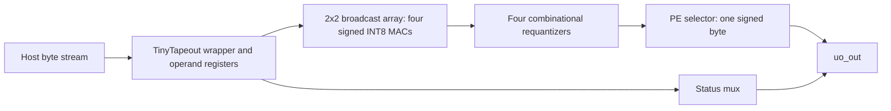

# Frozen architecture review

This candidate is `tt_um_tinyml_npu_2x2`, with four signed INT8 MAC PEs in
two rows and two columns, each with a signed 24-bit accumulator. Production
uses row activation / column weight broadcast (`SYSTOLIC_MODE=0`).
The generic `npu_array` additionally supports registered activation-east /
weight-south forwarding (`SYSTOLIC_MODE=1`), with host-supplied skew and drain.
It has no valid-wavefront controller. Neither mode is selectable at runtime
through the production wrapper. Host-controlled temporal reuse is possible;
there is no hardware Fold-SIMD scheduler. We use these precise descriptions
instead of asserting a named Kung-Leiserson implementation.

## Arithmetic contract

INT8 operands lie in [-128,127]. Actual product range is [-16256,16384],
within a signed 16-bit result. -128*-128=16384; -128*127=-16256;
127*127=16129. Product bits are explicitly sign-extended to 24 bits.
The 24-bit accumulator addition wraps modulo 2**24. Overflow flags describe
the most recent enabled MAC, not a sticky history; clear/load reset them.

From zero bias, 511 repeated maximum-positive products are safe;
512*16384=8388608 overflows. 516 repeated maximum-negative products are
safe; 517*(-16256)=-8404352 overflows. 520 repeated 127*127 products are
safe; the 521st overflows. The universal bound for arbitrary signed INT8
terms is 511, not a heuristic count of guard bits.

With initial bias B in [-8388608,8388607], a universal safe length is
min(floor((8388607-B)/16384), floor((8388608+B)/16256)). A boundary bias
can leave zero headroom. The K=1..64 wrapper is safe from zero for one
vector, but repeated vectors do not automatically clear accumulators.

Requantization adds a nonnegative rounding offset in signed 25-bit precision
before arithmetic right shift. This prevents the old positive-to-negative
wrap bug at acc=8388607, S=1. The exact rule rounds ties toward positive
infinity: -3/2 -> -1 and -1/2 -> 0. It is not symmetric/unbiased rounding.
There are four parallel combinational post-processors. At the production
port, all modes except ReLU share signed clipping; mode 11 is not unsigned
readout. Accumulator and forwarding outputs are available at core ports,
but the TinyTapeout wrapper exposes only quantized bytes and status.

## Neighbor-forwarding example (generic array only)

A=[[2,3],[4,5]], B=[[6,7],[8,9]]. Each table entry is the operands consumed
on that enabled MAC edge. Clear and zero the boundaries before the schedule.

| Edge | West A(r0,r1) | North B(c0,c1) | PE00 | PE01 | PE10 | PE11 |
|---|---|---|---|---|---|---|
| 0 | 2,0 | 6,0 | 2*6 | 0 | 0 | 0 |
| 1 | 3,4 | 8,7 | 3*8 | 2*7 | 4*6 | 0 |
| 2 | 0,5 | 0,9 | 0 | 3*9 | 5*8 | 4*7 |
| 3 | 0,0 | 0,0 | 0 | 0 | 0 | 5*9 |

Final row-major accumulators: [36,41,64,73]. PE(r,c) consumes term k at
edge k+r+c. A 2x2 product with inner dimension K needs K+2 enabled MAC
edges including the fill/drain wavefront. Forwarding registers advance on
every ena edge even with mac_en=0, and freeze with ena=0. Zero padding,
global MAC gating, operation clearing and completion timing are supplied
externally. The array has no output-valid signal. Production broadcast
instead consumes all four useful outer-product contributions on each MAC
edge; its byte wrapper cannot feed a useful MAC every clock.
